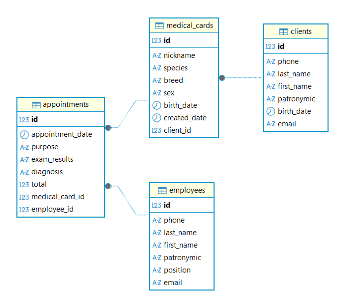
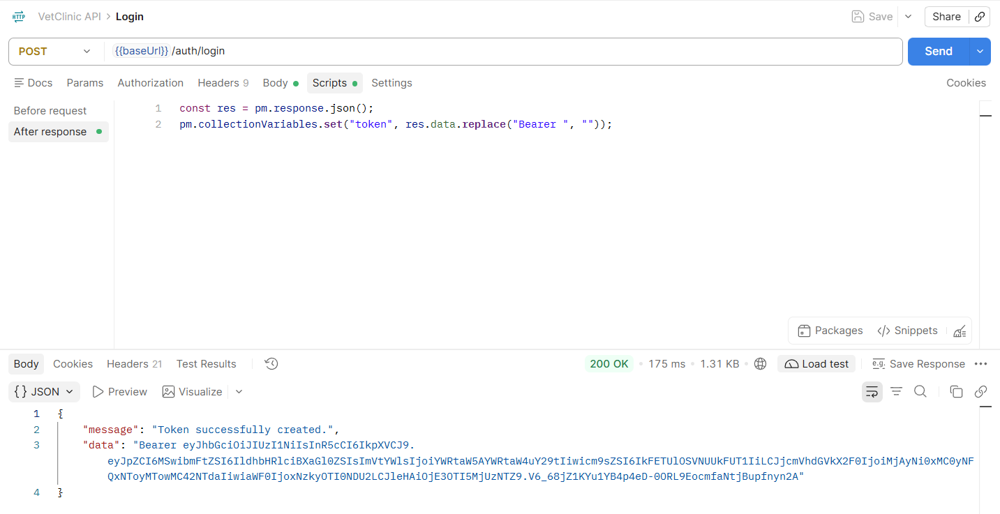
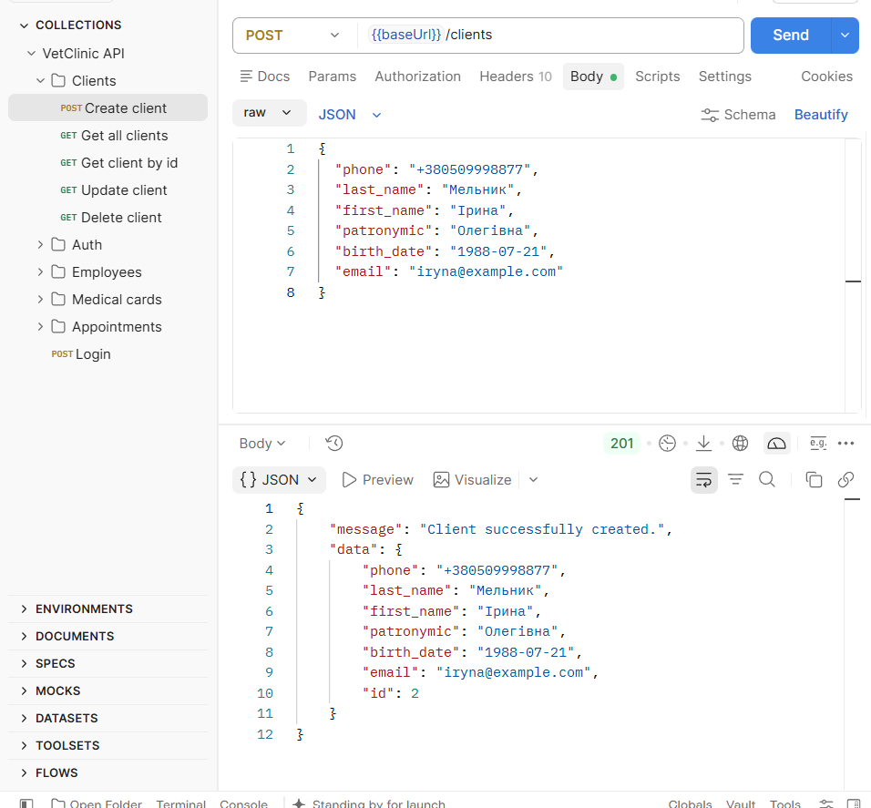
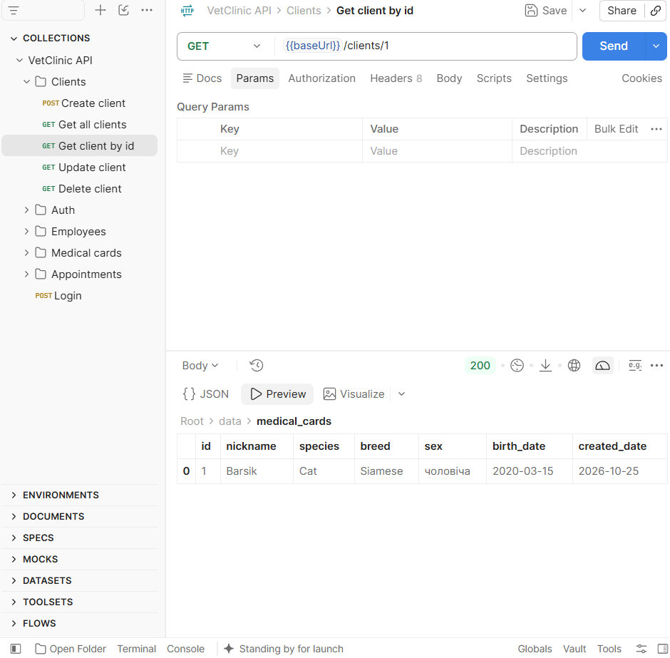
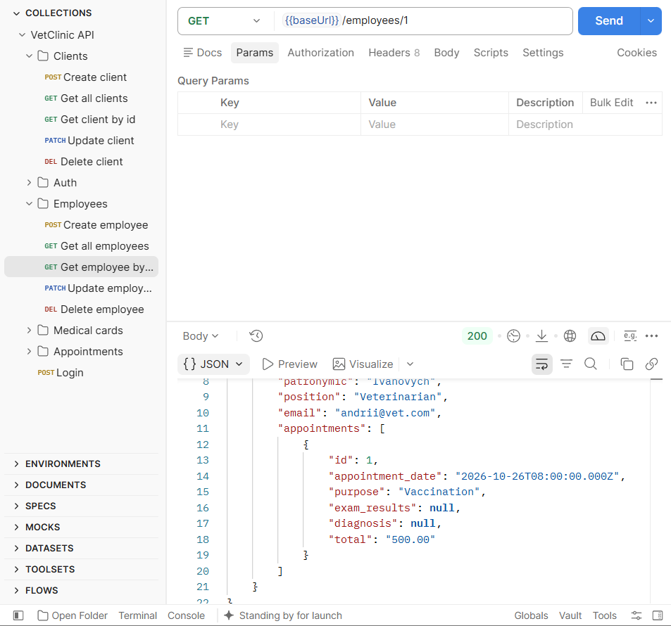
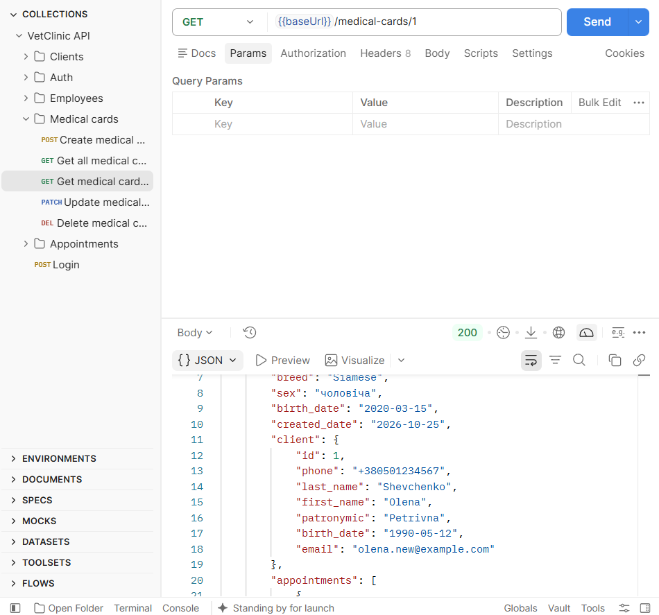
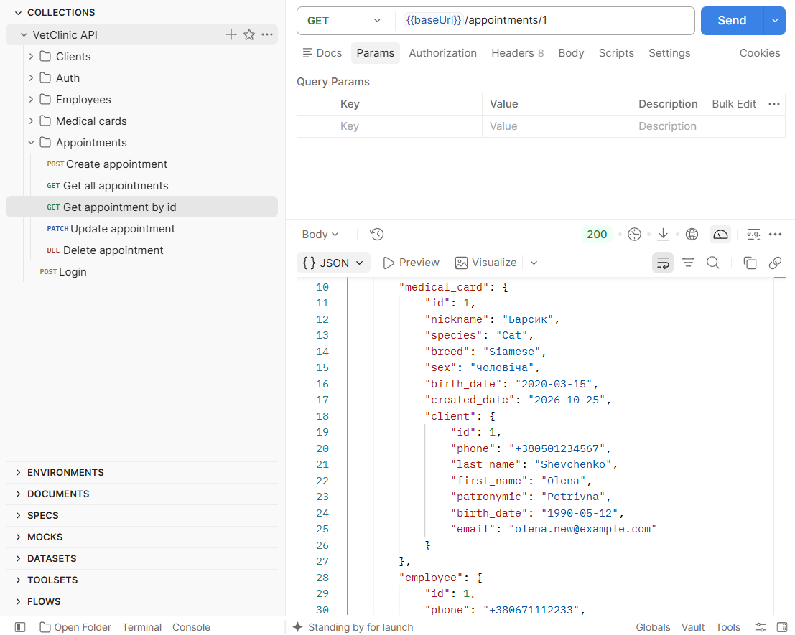
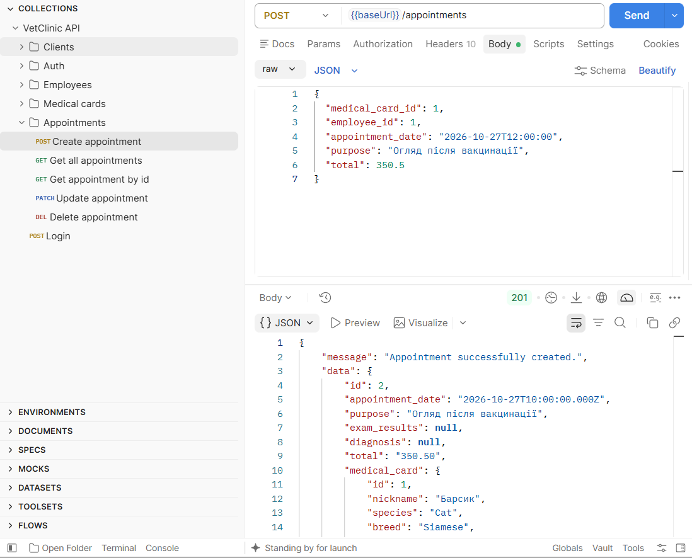
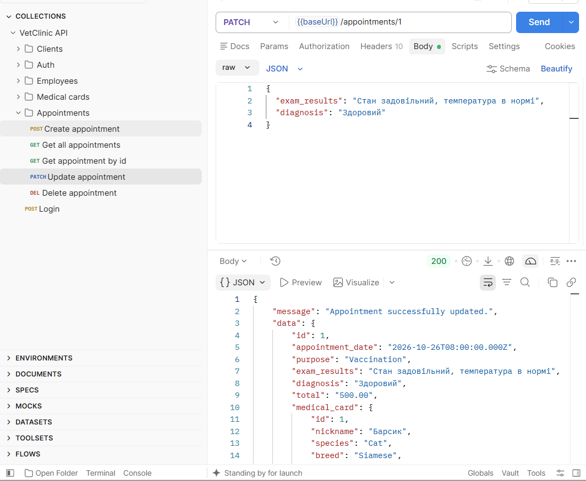
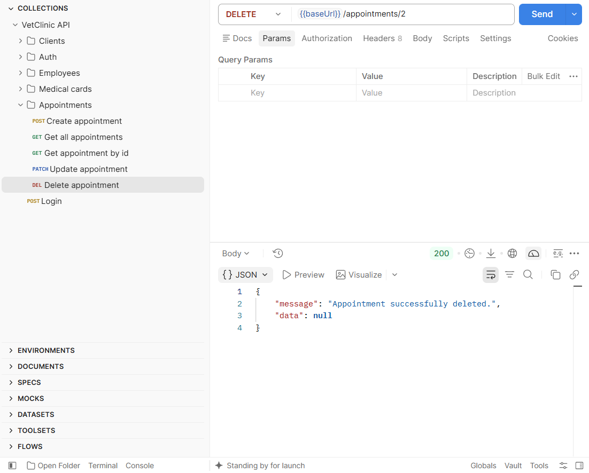

# VetClinic Backend

REST API для інформаційної системи «Ветеринарна клініка» (VetClinic IS). Проєкт створено на основі boilerplate [typeorm-express-typescript](https://github.com/mkosir/typeorm-express-typescript) у межах лабораторно-практичної роботи №5.

**Стек:** Node.js, Express, TypeORM, PostgreSQL 14, TypeScript, Docker Compose.

## Реалізовані сутності та зв'язки

### Сутності

**Client (`clients`)** — клієнт клініки, власник тварин.

| Поле | Тип | Обмеження |
|---|---|---|
| id | serial | первинний ключ |
| phone | varchar(13) | унікальне, формат `+380XXXXXXXXX` |
| last_name, first_name, patronymic | varchar(30) | обов'язкові |
| birth_date | date | обов'язкове, раніше за поточну дату |
| email | varchar(255) | унікальне, формат електронної пошти |

**Employee (`employees`)** — співробітник клініки.

| Поле | Тип | Обмеження |
|---|---|---|
| id | serial | первинний ключ |
| phone | varchar(13) | унікальне, формат `+380XXXXXXXXX` |
| last_name, first_name, patronymic | varchar(30) | обов'язкові |
| position | varchar(50) | обов'язкове |
| email | varchar(255) | унікальне, формат електронної пошти |

**MedicalCard (`medical_cards`)** — медична картка тварини.

| Поле | Тип | Обмеження |
|---|---|---|
| id | serial | первинний ключ |
| client_id | integer | зовнішній ключ на `clients` |
| nickname, species, breed | varchar(50) | обов'язкові |
| sex | varchar(10) | `чоловіча` або `жіноча` |
| birth_date | date | раніше за дату створення картки |
| created_date | date | за замовчуванням поточна дата |

**Appointment (`appointments`)** — прийом.

| Поле | Тип | Обмеження |
|---|---|---|
| id | serial | первинний ключ |
| medical_card_id | integer | зовнішній ключ на `medical_cards` |
| employee_id | integer | зовнішній ключ на `employees` |
| appointment_date | timestamp | обов'язкове |
| purpose | text | обов'язкове |
| exam_results | text | необов'язкове |
| diagnosis | varchar(255) | необов'язкове |
| total | numeric(10,2) | обов'язкове, більше нуля |

### Зв'язки

- **Client 1 → M MedicalCard**: клієнт може мати кілька тварин, картка належить одному клієнту (`OneToMany` / `ManyToOne`). Видалення клієнта видаляє його картки (`CASCADE`).
- **MedicalCard 1 → M Appointment**: на одну картку може бути багато прийомів, прийом стосується однієї картки. Видалення картки видаляє її прийоми (`CASCADE`).
- **Employee 1 → M Appointment**: співробітник проводить багато прийомів, прийом проводить один співробітник. Співробітника, який має прийоми, видалити не можна (зовнішній ключ без каскаду).

### ER-діаграма



## Архітектура

Для кожної сутності реалізовано повний шар:

- `src/orm/entities/` — сутності TypeORM;
- `src/orm/migrations/` — міграції (`CreateVetClinicTables`);
- `src/dto/` — DTO та валідація вхідних даних;
- `src/services/` — робота з базою даних;
- `src/controllers/` — обробка запитів;
- `src/routes/v1/` — маршрути.

## Запуск

1. Запустити базу даних:
   ```bash
   docker compose --file docker-compose.yml --file docker-compose.dev.yml up -d db_postgres
   ```
2. Встановити залежності та застосувати міграції:
   ```bash
   npm install
   npm run migration:run:dev
   ```
3. Запустити сервер:
   ```bash
   npm run dev
   ```

Сервер доступний на `http://localhost:4000`, база даних `vetclinic` на `localhost:8432`. Параметри підключення задано у файлі `.env`.

## Автентифікація

Усі ендпоінти сутностей захищені JWT. Спочатку потрібно отримати токен через `POST /v1/auth/login` (тестовий користувач `admin@admin.com` / `pass1`) і передавати його в заголовку `Authorization: Bearer <token>`. Токен дійсний 15 хвилин.



## API ендпоінти

Базовий префікс: `/v1`.

| Метод | Шлях | Опис |
|---|---|---|
| POST | `/auth/login` | Отримання токена |
| POST | `/clients` | Створити клієнта |
| GET | `/clients` | Список клієнтів (з їхніми картками) |
| GET | `/clients/:id` | Клієнт за ID (з його картками) |
| PATCH | `/clients/:id` | Оновити клієнта |
| DELETE | `/clients/:id` | Видалити клієнта |
| POST | `/employees` | Створити співробітника |
| GET | `/employees` | Список співробітників (з прийомами) |
| GET | `/employees/:id` | Співробітник за ID (з прийомами) |
| PATCH | `/employees/:id` | Оновити співробітника |
| DELETE | `/employees/:id` | Видалити співробітника |
| POST | `/medical-cards` | Створити медичну картку |
| GET | `/medical-cards` | Список карток (з клієнтом і прийомами) |
| GET | `/medical-cards/:id` | Картка за ID (з клієнтом і прийомами) |
| PATCH | `/medical-cards/:id` | Оновити картку |
| DELETE | `/medical-cards/:id` | Видалити картку |
| POST | `/appointments` | Створити прийом |
| GET | `/appointments` | Список прийомів (з карткою, клієнтом і співробітником) |
| GET | `/appointments/:id` | Прийом за ID (з карткою, клієнтом і співробітником) |
| PATCH | `/appointments/:id` | Оновити прийом |
| DELETE | `/appointments/:id` | Видалити прийом |

Колекцію Postman з усіма запитами збережено у файлі [`postman/VetClinic API.postman_collection.json`](postman/VetClinic%20API.postman_collection.json). Базова адреса й токен винесені у змінні колекції `baseUrl` та `token`, токен записується автоматично після запиту Login.

## Приклади запитів у Postman

### Створення клієнта

`POST /v1/clients` — відповідь `201`.



### Отримання даних із зв'язаних таблиць (join)

**Клієнт з медичними картками.** `GET /v1/clients/1` повертає клієнта з вкладеним масивом `medical_cards`.



**Співробітник з прийомами.** `GET /v1/employees/1` повертає співробітника з вкладеним масивом `appointments`.



**Медична картка з клієнтом.** `GET /v1/medical-cards/1` повертає картку з вкладеним об'єктом `client`.



**Прийом з карткою, клієнтом і співробітником.** `GET /v1/appointments/1` повертає прийом із вкладеним `medical_card` (всередині нього `client`) та `employee`.



### Створення, оновлення та видалення прийому

`POST /v1/appointments` — відповідь `201`.



`PATCH /v1/appointments/1` — відповідь `200`.



`DELETE /v1/appointments/2` — відповідь `200`.



Повний набір скріншотів тестування всіх ендпоінтів та етапів виконання роботи наведено у [report.md](report.md).