# VetClinic Backend

REST API для інформаційної системи «Ветеринарна клініка» (VetClinic IS). Проєкт створено на основі boilerplate [typeorm-express-typescript](https://github.com/mkosir/typeorm-express-typescript) у межах лабораторно-практичних робіт №5 і №6.

**Стек:** Node.js, Express, TypeORM, PostgreSQL 14, TypeScript, Docker Compose.

## Реалізовані сутності та зв'язки

### Сутності

**Client (`clients`)** — клієнт клініки, власник тварин.

| Поле | Тип | Обмеження |
|---|---|---|
| id | serial | первинний ключ |
| phone | varchar(13) | унікальне, формат `+380XXXXXXXXX` |
| last_name, first_name, patronymic | varchar(30) | обов'язкові |
| birth_date | date | обов'язкове, раніше за поточну дату |
| email | varchar(255) | унікальне, формат електронної пошти |

**Employee (`employees`)** — співробітник клініки.

| Поле | Тип | Обмеження |
|---|---|---|
| id | serial | первинний ключ |
| phone | varchar(13) | унікальне, формат `+380XXXXXXXXX` |
| last_name, first_name, patronymic | varchar(30) | обов'язкові |
| position | varchar(50) | обов'язкове |
| email | varchar(255) | унікальне, формат електронної пошти |

**MedicalCard (`medical_cards`)** — медична картка тварини.

| Поле | Тип | Обмеження |
|---|---|---|
| id | serial | первинний ключ |
| client_id | integer | зовнішній ключ на `clients` |
| nickname, species, breed | varchar(50) | обов'язкові |
| sex | varchar(10) | `чоловіча` або `жіноча` |
| birth_date | date | раніше за дату створення картки |
| created_date | date | за замовчуванням поточна дата |

**Appointment (`appointments`)** — прийом.

| Поле | Тип | Обмеження |
|---|---|---|
| id | serial | первинний ключ |
| medical_card_id | integer | зовнішній ключ на `medical_cards` |
| employee_id | integer | зовнішній ключ на `employees` |
| appointment_date | timestamp | обов'язкове |
| purpose | text | обов'язкове |
| exam_results | text | необов'язкове |
| diagnosis | varchar(255) | необов'язкове |
| total | numeric(10,2) | обов'язкове, більше нуля |

### Зв'язки

- **Client 1 → M MedicalCard**: клієнт може мати кілька тварин, картка належить одному клієнту (`OneToMany` / `ManyToOne`). Видалення клієнта видаляє його картки (`CASCADE`).
- **MedicalCard 1 → M Appointment**: на одну картку може бути багато прийомів, прийом стосується однієї картки. Видалення картки видаляє її прийоми (`CASCADE`).
- **Employee 1 → M Appointment**: співробітник проводить багато прийомів, прийом проводить один співробітник. Співробітника, який має прийоми, видалити не можна (зовнішній ключ без каскаду).

### ER-діаграма

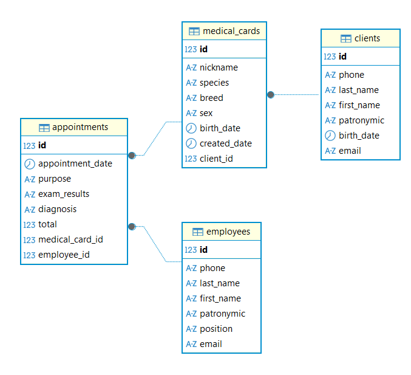

## Архітектура

Для кожної сутності реалізовано повний шар:

- `src/orm/entities/` — сутності TypeORM;
- `src/orm/migrations/` — міграції (`CreateVetClinicTables`);
- `src/dto/` — DTO для вхідних даних і ResponseDTO для відповідей;
- `src/services/` — сервіс-класи з роботою з базою даних;
- `src/middleware/validation/` — middleware-функції валідації вхідних даних;
- `src/controllers/` — обробка запитів;
- `src/routes/v1/` — маршрути.

## Архітектура шарів (лабораторна робота №6)

У межах лабораторної роботи №6 проведено рефакторинг за принципом розділення відповідальності (Separation of Concerns). Запит проходить через такі шари:

```
Запит → Router → Middleware (валідація) → Controller → Service → Repository → БД
                                              ↓
                                        ResponseDTO → Відповідь
```

### Роль кожного шару

- **Middleware (валідація).** Перевіряє тіло запиту (`req.body`) до виклику контролера за допомогою бібліотеки `validator`. Якщо дані некоректні, формує помилку `400 Bad Request` і передає її в обробник помилок, а контролер взагалі не викликається.
- **Controller (оркестрація).** Приймає HTTP-запит, створює екземпляр сервісу, викликає його методи, перетворює результат у ResponseDTO та формує HTTP-відповідь. Бізнес-логіки й роботи з базою даних у контролері немає.
- **Service (бізнес-логіка).** Містить усю логіку роботи з сутністю: пошук, створення, оновлення, видалення, перевірку існування зв'язаних записів (наприклад, чи існує клієнт при створенні картки). Не знає про HTTP.
- **Repository (доступ до даних).** Репозиторій TypeORM (`getRepository(Entity)`), який виконує запити до PostgreSQL. Використовується лише всередині сервісів.

### Middleware валідації

Для кожної сутності створено дві middleware-функції (для створення й для часткового оновлення через PATCH) та спільний файл правил. Приклад для сутності Client:

`src/middleware/validation/clients/validatorCreateClient.ts`

```ts
import { Request, Response, NextFunction } from 'express';

import { CustomError } from 'utils/response/custom-error/CustomError';

import { checkClientBody } from './clientRules';

export async function validatorCreateClient(req: Request, res: Response, next: NextFunction): Promise<void> {
  try {
    const errors = checkClientBody(req.body, false);
    if (errors.length > 0) {
      throw new CustomError(400, 'Validation', 'Validation error.', errors);
    }
    return next();
  } catch (err) {
    return next(err);
  }
}
```

Правила перевірки (`clientRules.ts`) використовують функції бібліотеки `validator` (`isEmpty`, `isEmail`, `isLength`, `isDate`, `matches`). Помилка передається через `next(err)`, оскільки в Express 4 виняток з `async`-функції сам не потрапляє в обробник помилок.

Підключення до маршруту (`src/routes/v1/clients.ts`): middleware стоїть після перевірки JWT і перед контролером.

```ts
router.post('/', [checkJwt, validatorCreateClient], create);
router.patch('/:id([0-9]+)', [checkJwt, validatorUpdateClient], update);
```

### Сервіс-клас

`src/services/clients/ClientService.ts`

```ts
import { getRepository } from 'typeorm';

import { ClientDto } from 'dto/clients/ClientDto';
import { Client } from 'orm/entities/clients/Client';

export class ClientService {
  private clientRepository = getRepository(Client);

  async findAll(): Promise<Client[]> {
    return this.clientRepository.find({ relations: ['medical_cards'], order: { id: 'ASC' } });
  }

  async findOne(id: number): Promise<Client | undefined> {
    return this.clientRepository.findOne(id, { relations: ['medical_cards'] });
  }

  async create(data: ClientDto): Promise<Client> {
    const client = this.clientRepository.create(data);
    return this.clientRepository.save(client);
  }

  async update(id: number, data: Partial<ClientDto>): Promise<Client | undefined> {
    const client = await this.clientRepository.findOne(id);
    if (!client) return undefined;
    Object.assign(client, data);
    return this.clientRepository.save(client);
  }

  async delete(id: number): Promise<boolean> {
    const client = await this.clientRepository.findOne(id);
    if (!client) return false;
    await this.clientRepository.remove(client);
    return true;
  }
}
```

### ResponseDTO

ResponseDTO описує публічну структуру відповіді. Конструктор приймає entity і виставляє назовні лише потрібні поля. Прізвище, ім'я та по батькові об'єднуються в `full_name`, вкладені об'єкти теж перетворюються у DTO.

`src/dto/appointments/AppointmentResponseDTO.ts`

```ts
import { Appointment } from 'orm/entities/appointments/Appointment';

import { EmployeeShortDTO } from '../shared/EmployeeShortDTO';
import { MedicalCardShortDTO } from '../shared/MedicalCardShortDTO';

export class AppointmentResponseDTO {
  id: number;
  appointment_date: Date;
  purpose: string;
  exam_results: string;
  diagnosis: string;
  total: number;
  medical_card?: MedicalCardShortDTO;
  employee?: EmployeeShortDTO;

  constructor(appointment: Appointment) {
    this.id = appointment.id;
    this.appointment_date = appointment.appointment_date;
    this.purpose = appointment.purpose;
    this.exam_results = appointment.exam_results;
    this.diagnosis = appointment.diagnosis;
    this.total = Number(appointment.total);
    if (appointment.medical_card) {
      this.medical_card = new MedicalCardShortDTO(appointment.medical_card);
    }
    if (appointment.employee) {
      this.employee = new EmployeeShortDTO(appointment.employee);
    }
  }
}
```

Контролер після отримання entity від сервісу повертає саме DTO:

```ts
const appointment = await appointmentService.findOne(id);
res.customSuccess(200, 'Appointment found.', new AppointmentResponseDTO(appointment));
```

### Приклади у Postman (лабораторна робота №6)

**Запит із некоректними даними: `400 Bad Request` від middleware.** `POST /v1/clients` з невалідними телефоном, датою народження та поштою. У стеку помилки видно `validatorCreateClient.ts`, тобто запит зупинено до контролера.

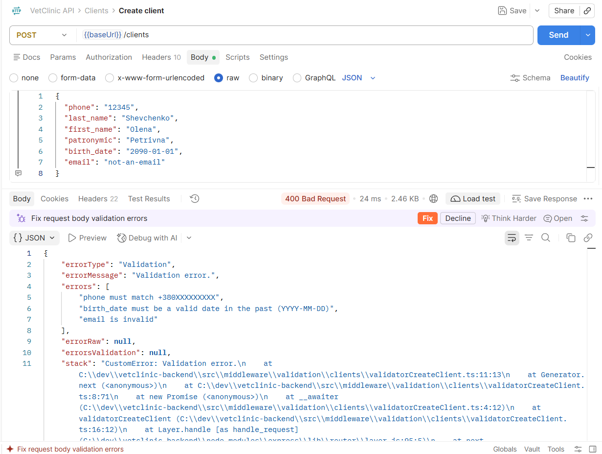

**Успішний запит зі структурою ResponseDTO.** `GET /v1/appointments/1`: поле `total` повертається числом, ПІБ об'єднано в `full_name`, вкладені `medical_card` (з `client`) та `employee` містять лише публічні поля.

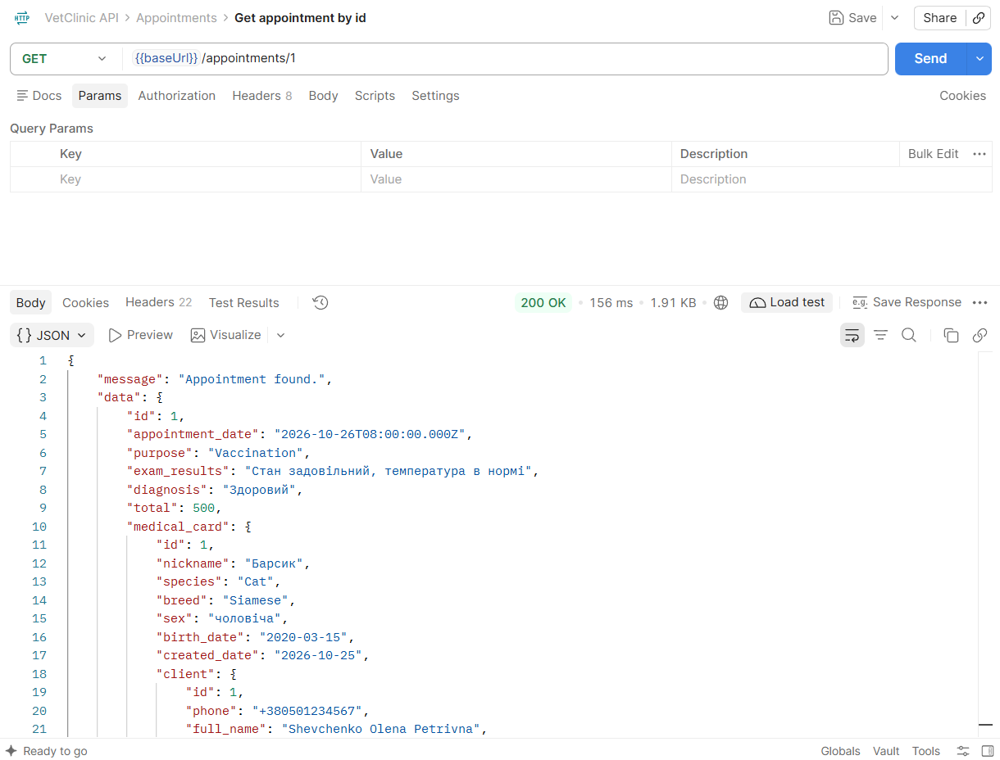

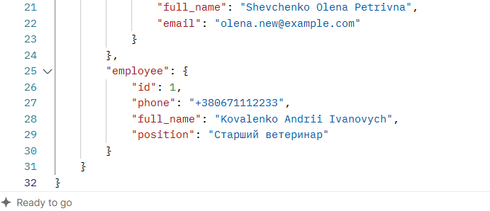

## Запуск

1. Запустити базу даних:
   ```bash
   docker compose --file docker-compose.yml --file docker-compose.dev.yml up -d db_postgres
   ```
2. Встановити залежності та застосувати міграції:
   ```bash
   npm install
   npm run migration:run:dev
   ```
3. Запустити сервер:
   ```bash
   npm run dev
   ```

Сервер доступний на `http://localhost:4000`, база даних `vetclinic` на `localhost:8432`. Параметри підключення задано у файлі `.env`.

## Автентифікація

Усі ендпоінти сутностей захищені JWT. Спочатку потрібно отримати токен через `POST /v1/auth/login` (тестовий користувач `admin@admin.com` / `pass1`) і передавати його в заголовку `Authorization: Bearer <token>`. Токен дійсний 15 хвилин.

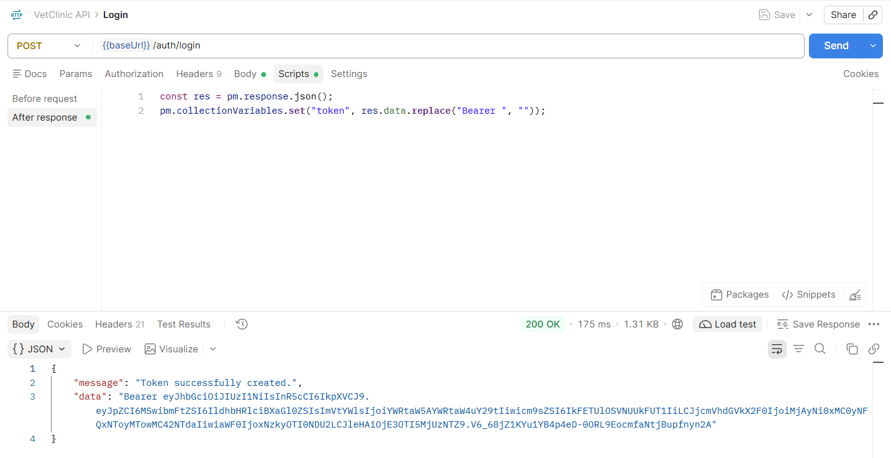

## API ендпоінти

Базовий префікс: `/v1`.

| Метод | Шлях | Опис |
|---|---|---|
| POST | `/auth/login` | Отримання токена |
| POST | `/clients` | Створити клієнта |
| GET | `/clients` | Список клієнтів (з їхніми картками) |
| GET | `/clients/:id` | Клієнт за ID (з його картками) |
| PATCH | `/clients/:id` | Оновити клієнта |
| DELETE | `/clients/:id` | Видалити клієнта |
| POST | `/employees` | Створити співробітника |
| GET | `/employees` | Список співробітників (з прийомами) |
| GET | `/employees/:id` | Співробітник за ID (з прийомами) |
| PATCH | `/employees/:id` | Оновити співробітника |
| DELETE | `/employees/:id` | Видалити співробітника |
| POST | `/medical-cards` | Створити медичну картку |
| GET | `/medical-cards` | Список карток (з клієнтом і прийомами) |
| GET | `/medical-cards/:id` | Картка за ID (з клієнтом і прийомами) |
| PATCH | `/medical-cards/:id` | Оновити картку |
| DELETE | `/medical-cards/:id` | Видалити картку |
| POST | `/appointments` | Створити прийом |
| GET | `/appointments` | Список прийомів (з карткою, клієнтом і співробітником) |
| GET | `/appointments/:id` | Прийом за ID (з карткою, клієнтом і співробітником) |
| PATCH | `/appointments/:id` | Оновити прийом |
| DELETE | `/appointments/:id` | Видалити прийом |

Колекцію Postman з усіма запитами збережено у файлі [`postman/VetClinic API.postman_collection.json`](postman/VetClinic%20API.postman_collection.json). Базова адреса й токен винесені у змінні колекції `baseUrl` та `token`, токен записується автоматично після запиту Login.

## Приклади запитів у Postman (лабораторна робота №5)

### Створення клієнта

`POST /v1/clients` — відповідь `201`.

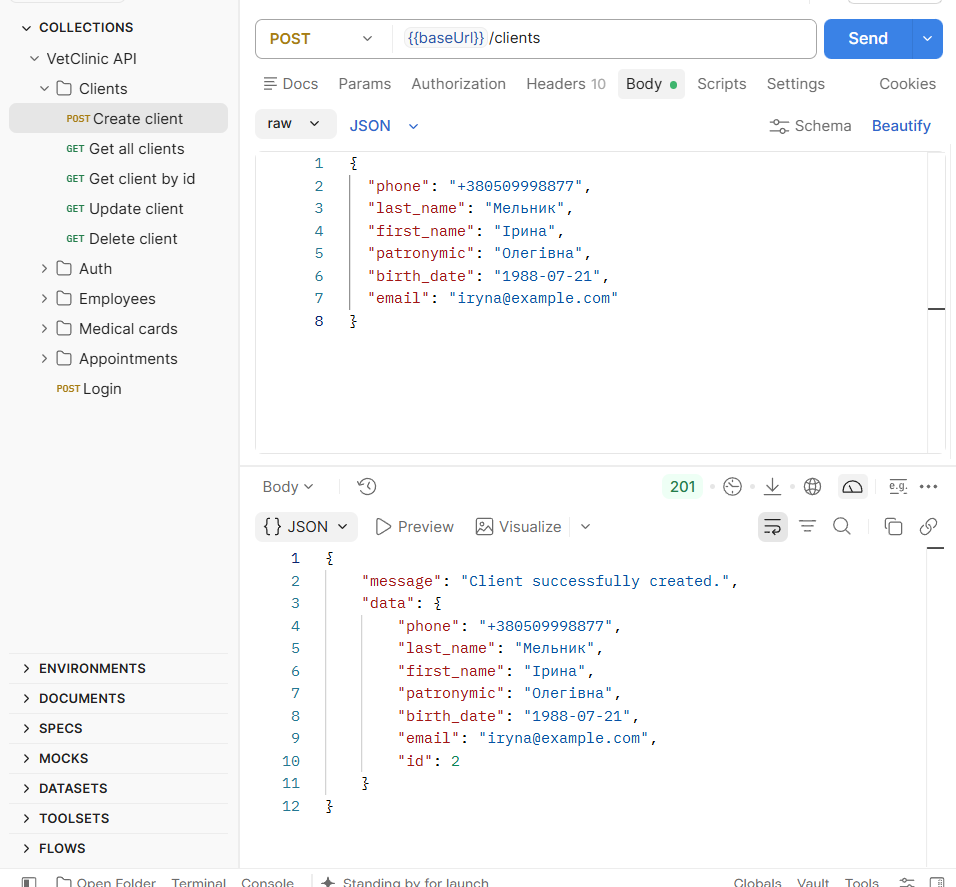

### Отримання даних із зв'язаних таблиць (join)

**Клієнт з медичними картками.** `GET /v1/clients/1` повертає клієнта з вкладеним масивом `medical_cards`.

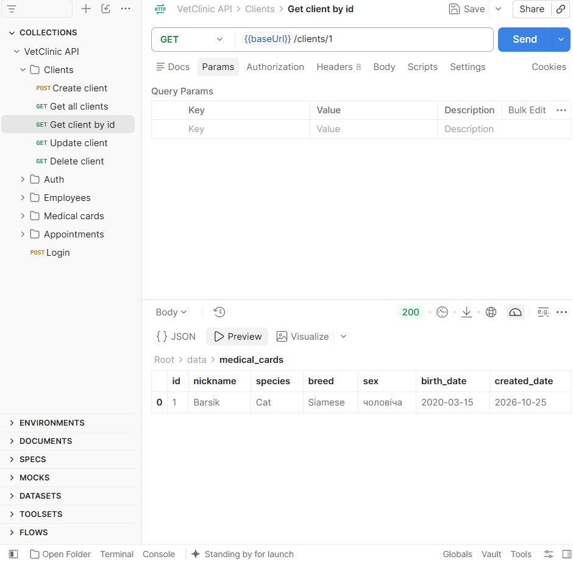

**Співробітник з прийомами.** `GET /v1/employees/1` повертає співробітника з вкладеним масивом `appointments`.

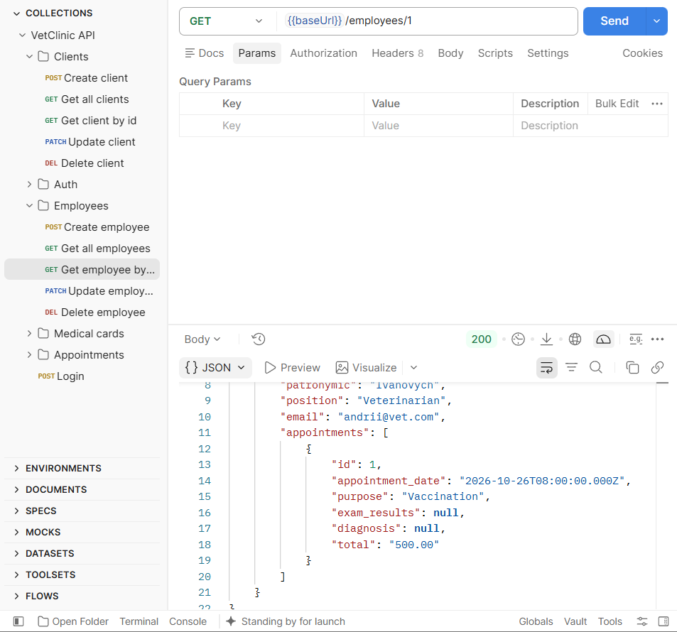

**Медична картка з клієнтом.** `GET /v1/medical-cards/1` повертає картку з вкладеним об'єктом `client`.

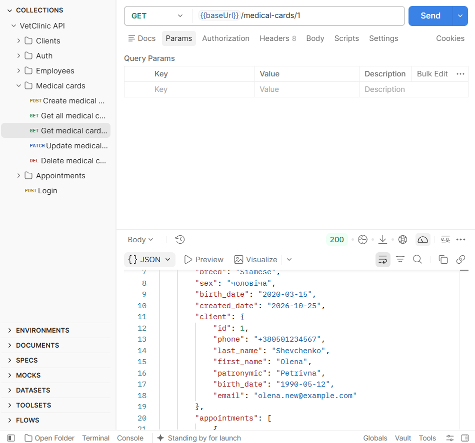

**Прийом з карткою, клієнтом і співробітником.** `GET /v1/appointments/1` повертає прийом із вкладеним `medical_card` (всередині нього `client`) та `employee`.

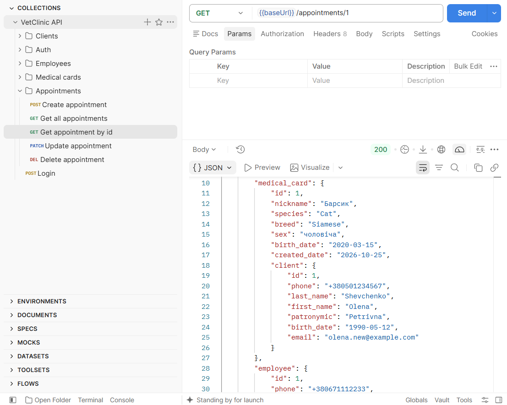

### Створення, оновлення та видалення прийому

`POST /v1/appointments` — відповідь `201`.

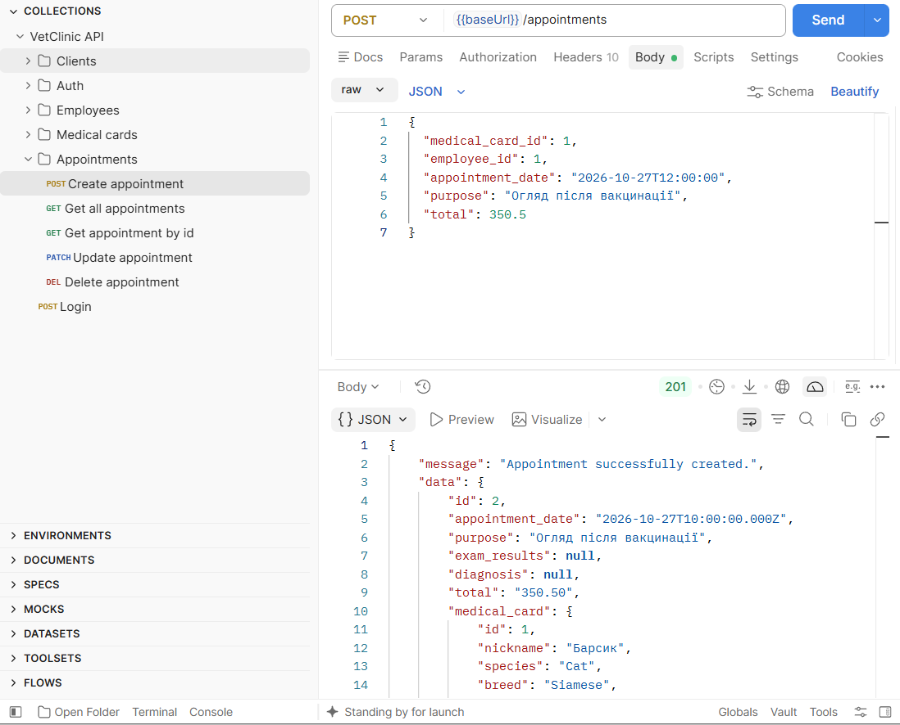

`PATCH /v1/appointments/1` — відповідь `200`.

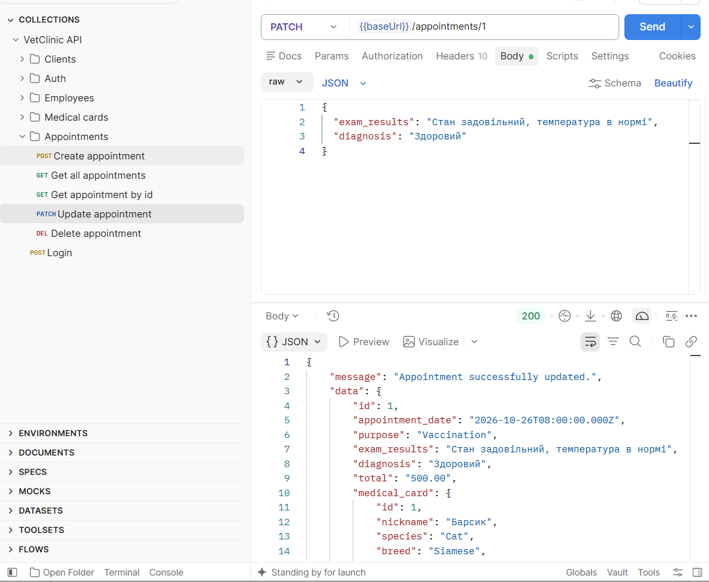

`DELETE /v1/appointments/2` — відповідь `200`.

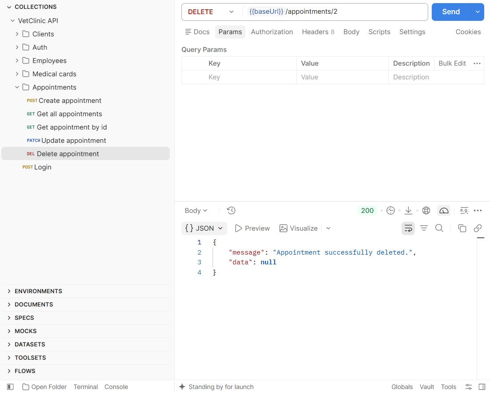

## Структура проєкту після рефакторингу

Каталоги `controllers` та `dto`:

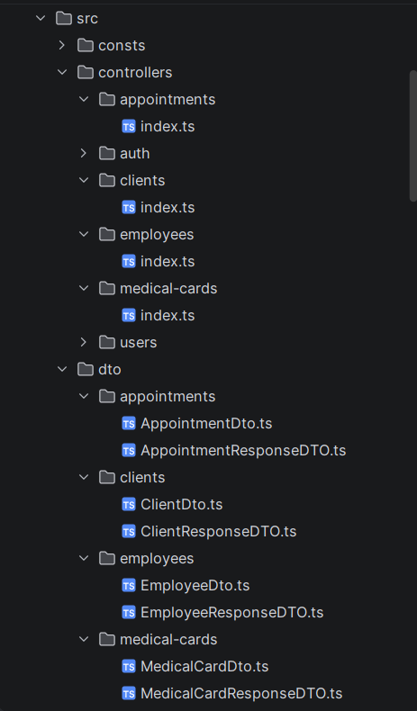

Каталоги `dto/shared` та `middleware/validation`:

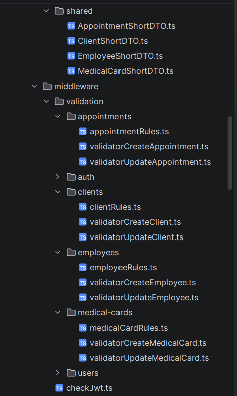

Каталоги `orm` та `routes/v1`:

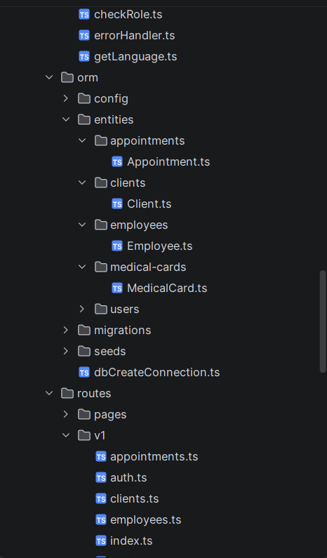

Каталоги `services` та `utils`:

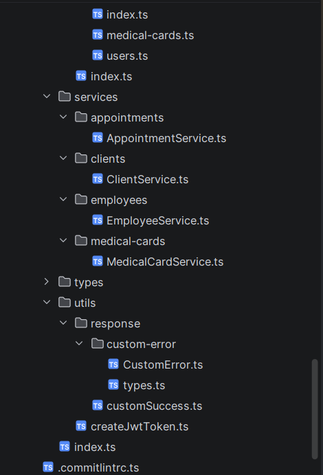

Повний набір скріншотів тестування всіх ендпоінтів та етапів виконання роботи наведено у [report.md](report.md).