# Лабораторно-практична робота №6

**на тему:** "Впровадження сервісного шару, валідації та DTO."

**Мета:** Навчитись проєктувати та реалізовувати правильну архітектуру бекенд-додатку за принципом розділення відповідальності (Separation of Concerns). Практично реалізувати сервісний шар, впровадити механізм валідації через middleware та навчитись формувати контрольовані відповіді API за допомогою DTO.

URL репозиторію: https://github.com/FLEI-byte/vetclinic-backend

**Рефакторинг виконано для сутностей:** `Client`, `Employee`, `MedicalCard`, `Appointment`.

---

## Етап 1. Створення та впровадження сервісного шару

1. Перетворення сервісу Client на клас

   Сервіс `ClientService` (`src/services/clients/ClientService.ts`) переписано зі статичних методів на звичайний клас. Репозиторій TypeORM став приватним полем класу (`private clientRepository = getRepository(Client)`). Методи названо за методичкою: `findAll`, `findOne`, `create`, `update`, `delete`. Додано типи результатів, наприклад `Promise<Client | undefined>`.

---

2. Сервіси Employee, MedicalCard та Appointment

   За тим самим зразком переписано `EmployeeService`, `MedicalCardService` та `AppointmentService`. Уся логіка роботи з репозиторієм (пошук, збереження, видалення, завантаження зв'язаних записів через `relations`) зосереджена в сервісах. Перевірку існування зв'язаних записів збережено в сервісах: `MedicalCardService` перевіряє наявність клієнта, `AppointmentService` перевіряє наявність медичної картки та співробітника і повертає код помилки `MEDICAL_CARD_NOT_FOUND` або `EMPLOYEE_NOT_FOUND`.

---

3. Оновлення контролерів

   У контролерах усіх чотирьох сутностей (`src/controllers/*/index.ts`) більше немає роботи з репозиторієм. Кожна функція-контролер створює екземпляр сервісу (наприклад, `const clientService = new ClientService();`) і викликає його методи. Перевірка `npm run lint` (ESLint і `tsc`) після змін пройшла без помилок.

---

4. Перевірка роботи сервісного шару в Postman

   Після рефакторингу виконано запит `GET {{baseUrl}}/appointments/1`. Відповідь має статус `200 OK` і містить вкладені дані `medical_card` та `client`. Це підтверджує, що сервісний шар працює і join-відповіді збереглися.

   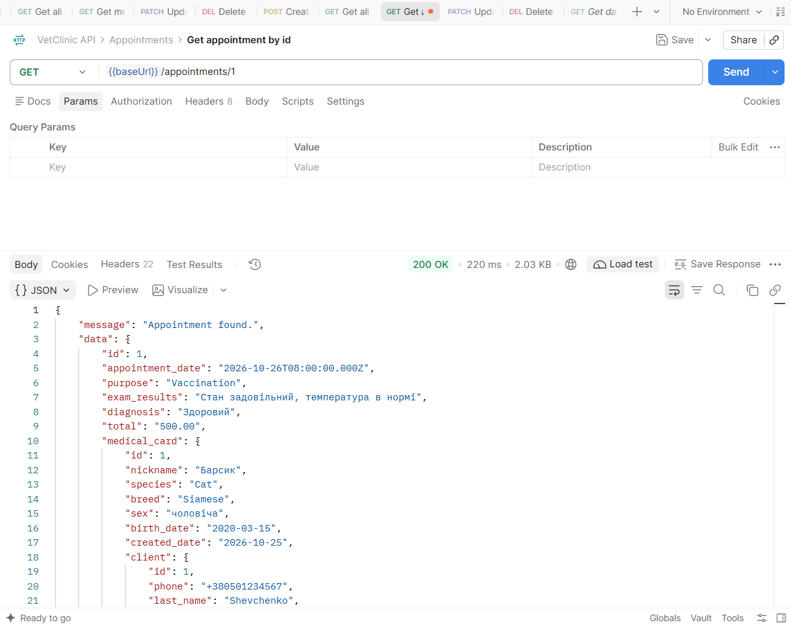

   Продовження відповіді: решта даних клієнта та вкладений `employee`.

   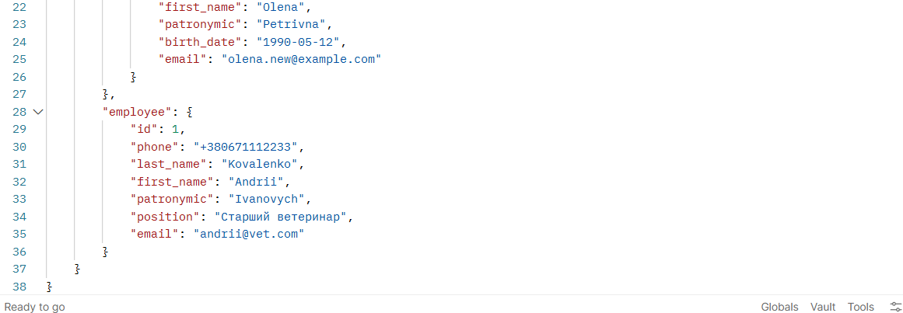

---

## Етап 2. Створення middleware-функцій для валідації

1. Правила валідації

   Для кожної сутності створено файл правил у теці `src/middleware/validation/<сутність>/` (`clientRules.ts`, `employeeRules.ts`, `medicalCardRules.ts`, `appointmentRules.ts`). Правила перевіряють `req.body` за допомогою бібліотеки `validator` (`isEmpty`, `isEmail`, `isLength`, `isDate`, `isFloat`, `matches`). Старі функції `validate...Dto` з DTO-файлів видалено, щоб логіка валідації не дублювалась.

   Під час реалізації виявлено, що типи `@types/validator` не підтримують іменований імпорт (`import { isEmail } from 'validator'`). Імпорт замінено на `import validator from 'validator'`, виклики записано як `validator.isEmail(...)`.

---

2. Middleware для створення та оновлення

   Для кожної сутності створено дві асинхронні middleware-функції: `validatorCreate<Сутність>` (усі поля обов'язкові) та `validatorUpdate<Сутність>` (перевіряються лише передані поля, оскільки оновлення виконується через PATCH). У разі помилки створюється `CustomError` зі статусом 400 і типом `Validation`. Помилка передається через `next(err)`, оскільки в Express 4 виняток із `async`-функції сам не потрапляє в обробник помилок.

---

3. Підключення middleware до маршрутів

   У файлах маршрутів (`src/routes/v1/*.ts`) middleware додано в ланцюжок обробки після `checkJwt` і перед контролером:

   `router.post('/', [checkJwt, validatorCreateClient], create);`

   `router.patch('/:id([0-9]+)', [checkJwt, validatorUpdateClient], update);`

   З контролерів видалено дубльовану перевірку даних.

---

4. Перевірка в Postman: запит із некоректними даними

   Виконано `POST {{baseUrl}}/clients` з невалідними даними: телефон `12345`, дата народження в майбутньому, пошта `not-an-email`. Сервер повернув `400 Bad Request` із `errorType: "Validation"` та масивом `errors` із трьома повідомленнями. У стеку помилки видно файл `validatorCreateClient.ts`, тобто запит зупинено в middleware ще до виклику контролера.

   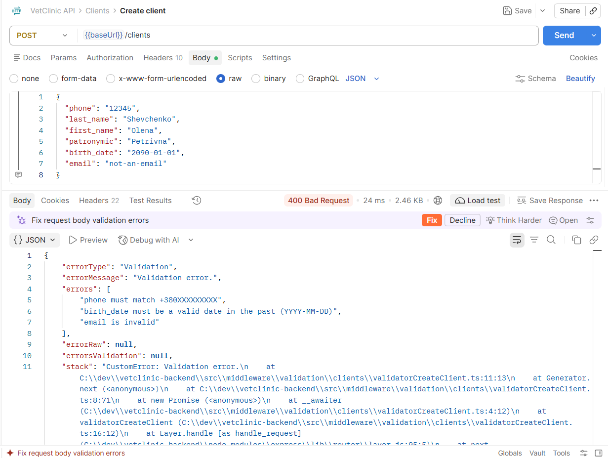

   Продовження стеку помилки:

   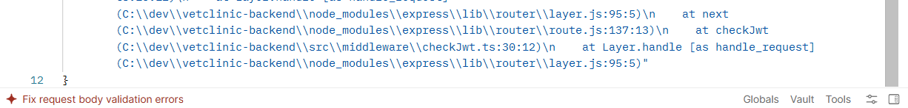

---

5. Коміт змін

   Зміни закомічено й відправлено в репозиторій (`refactor: add service classes and validation middleware`).

   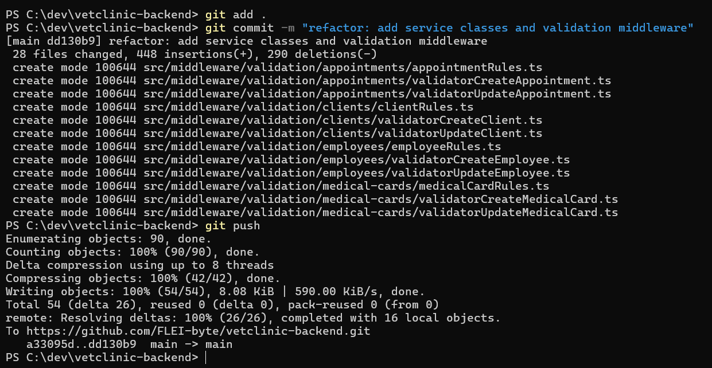

---

## Етап 3. Формування ResponseDTO

1. Створення ResponseDTO

   Для кожної сутності створено клас відповіді (`ClientResponseDTO`, `EmployeeResponseDTO`, `MedicalCardResponseDTO`, `AppointmentResponseDTO`) у теці `src/dto/<сутність>/`. Конструктор класу приймає entity і виставляє назовні лише публічні поля. Прізвище, ім'я та по батькові об'єднано в одне поле `full_name`, числове поле `total` повертається числом, а не рядком `"500.00"`.

---

2. Короткі DTO для вкладених об'єктів

   Щоб у join-відповідях теж не віддавались «сирі» entity і не виникало циклічних імпортів, у теці `src/dto/shared/` створено короткі DTO: `ClientShortDTO`, `EmployeeShortDTO`, `MedicalCardShortDTO`, `AppointmentShortDTO`. ResponseDTO використовують їх для вкладених даних.

---

3. Використання DTO в контролерах

   У контролерах усіх сутностей після отримання entity від сервісу створюється екземпляр ResponseDTO, і клієнту повертається саме він. Для списків використано `map`:

   `clients.map((client) => new ClientResponseDTO(client))`

---

4. Перевірка в Postman: успішний запит зі структурою ResponseDTO

   Виконано `GET {{baseUrl}}/appointments/1`. Відповідь має статус `200 OK`. Поле `total` повертається числом (`500`), вкладений `medical_card` містить `client` з полем `full_name`.

   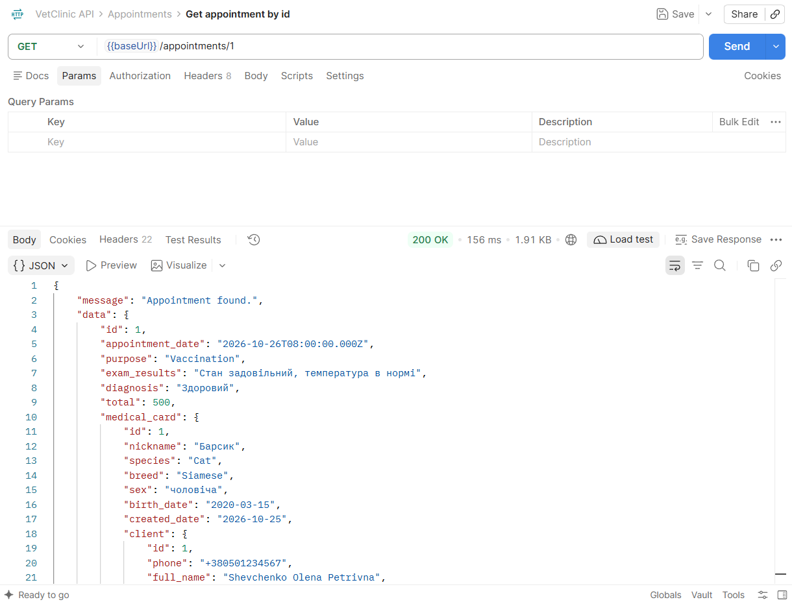

   Решта відповіді: вкладений `employee` з полями `full_name` та `position`.

   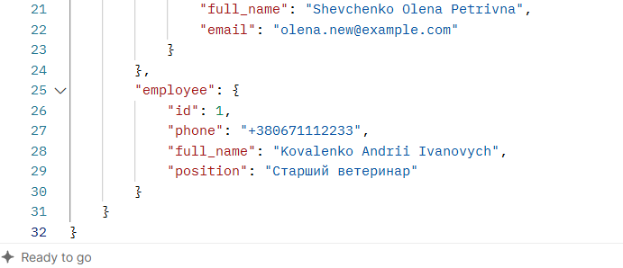

---

5. Коміт змін

   Зміни закомічено й відправлено в репозиторій (`refactor: add ResponseDTO and use it in controllers`).

   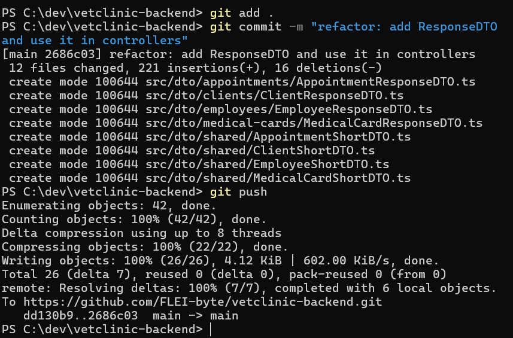

---

## Етап 4. Структура проєкту та оновлення README.md

1. Структура проєкту після рефакторингу

   Нова архітектура відображена в структурі `src`: контролери в `controllers`, DTO та ResponseDTO в `dto` (включно з `dto/shared`), middleware валідації в `middleware/validation`, сервіс-класи в `services`.

   Каталоги `controllers` та `dto`:

   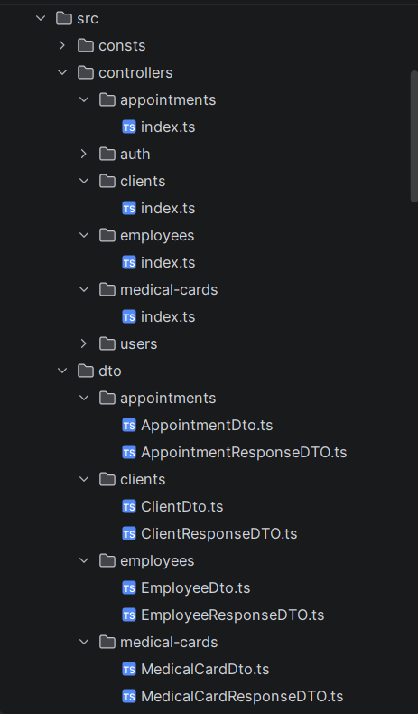

   Каталоги `dto/shared` та `middleware/validation`:

   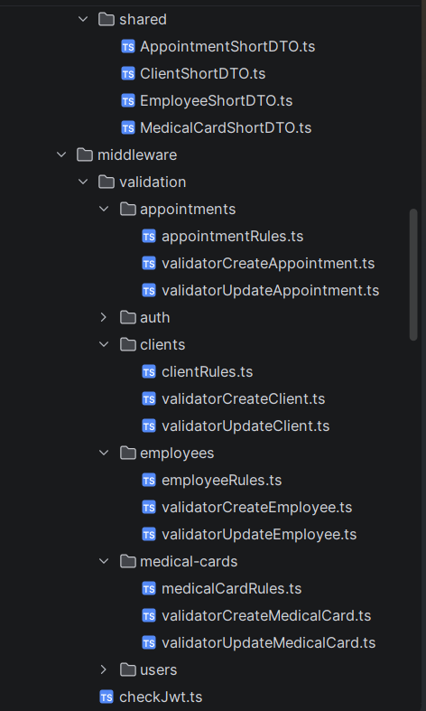

   Каталоги `orm` та `routes/v1`:

   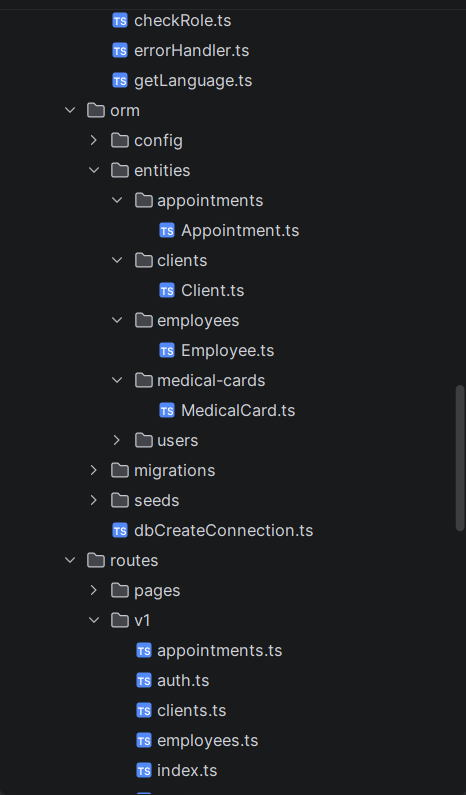

   Каталоги `services` та `utils`:

   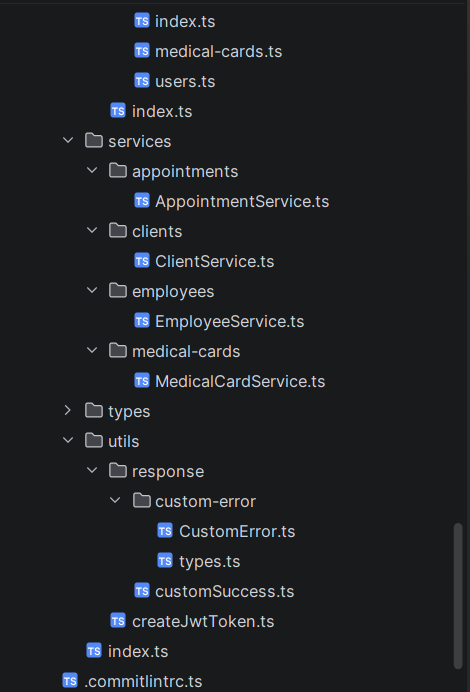

---

2. Оновлення README.md

   У `README.md` додано розділ «Архітектура шарів (лабораторна робота №6)». У ньому пояснено роль кожного шару (Middleware, Controller, Service, Repository), наведено приклади коду middleware-функції, сервіс-класу та ResponseDTO, а також додано скріншоти Postman із помилкою 400 і успішною відповіддю зі структурою ResponseDTO. Усі матеріали лабораторної роботи №5 у README збережено.

   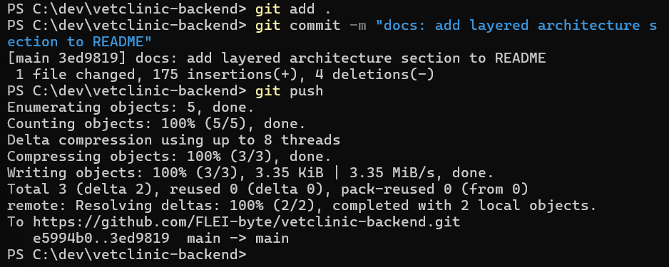

---

## Висновок

У ході роботи проведено рефакторинг бекенд-додатку «Ветеринарна клініка» за принципом розділення відповідальності. Для кожної сутності створено сервіс-клас, який інкапсулює всю роботу з репозиторієм, а контролери тепер лише створюють екземпляр сервісу й викликають його методи. Валідацію вхідних даних винесено в асинхронні middleware-функції на основі бібліотеки `validator`, які підключено до маршрутів перед контролерами. Відповіді API формуються через ResponseDTO, що приховує зайві поля, об'єднує ПІБ у `full_name` і повертає `total` числом. Тестування в Postman підтвердило, що некоректні дані зупиняються middleware з помилкою 400, а успішні запити повертають контрольовану структуру ResponseDTO з вкладеними даними. README.md оновлено описом нової архітектури, результати збережено в існуючому GitHub-репозиторії.
